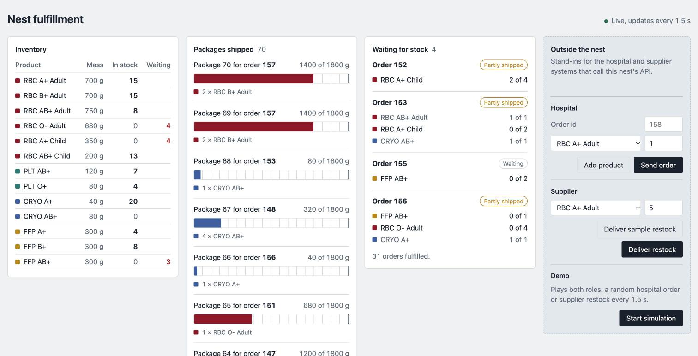

# Nest Fulfillment

An inventory management and order fulfillment system for a single Zipline distribution center ("nest"). It accepts a product catalog, hospital orders, and restocks, and turns orders into packages of at most 1.8 kg, shipping what stock allows right away and the rest as restocks arrive.

- **Backend:** Python, FastAPI, in-memory state, a framework-free domain core
- **Frontend:** React + TypeScript (Vite), an operator dashboard

The full problem statement, design, and tradeoffs are in **[DESIGN.md](DESIGN.md)**.



## Quick start

Requirements: Python 3.12+, [uv](https://docs.astral.sh/uv/), Node 20+.

```bash
make install   # backend (uv sync) + frontend (npm install)
make dev       # backend on :8000, frontend on :5173
```

Open http://localhost:5173 for the dashboard, or http://localhost:8000/docs for interactive API docs.

| Command | What it does |
| --- | --- |
| `make test` | Backend tests (pytest + hypothesis) |
| `make lint` | ruff (backend) and oxlint (frontend) |
| `make fmt` | Auto-format the backend |

## Try it

**In the dashboard** (http://localhost:5173):

The left side is what the nest operator sees: inventory, packages shipped, and orders waiting for stock. It only displays state. The **Outside the nest** column on the right stands in for the systems that call the API: a hospital sending orders, a supplier delivering restocks, and a demo that plays both.

1. Click **Load sample catalog**. All 13 products start at 0.
2. Under **Hospital**, click **Send order**. With no stock it waits under **Waiting for stock**.
3. Under **Supplier**, click **Deliver sample restock**. The waiting order ships at once, split into packages of at most 1800 g.
4. Under **Demo**, click **Start simulation** to send random orders and restocks every 1.5 s.
5. To see duplicate-order handling, type an existing order id under **Hospital** with different products and send it.

Every package is also printed to the backend console in the spec's `ship_package` shape.

**With curl**, using the spec's sample payloads (run from `backend/`, where `samples/` lives):

```bash
curl -X PUT  localhost:8000/api/catalog  -H 'Content-Type: application/json' -d @samples/catalog.json
curl -X POST localhost:8000/api/orders   -H 'Content-Type: application/json' -d @samples/order.json
curl -X POST localhost:8000/api/restocks -H 'Content-Type: application/json' -d @samples/restock.json
```

The order waits (no stock yet). The restock ships it as two packages, and the backend console prints:

```json
{"order_id": 123, "shipped": [{"product_id": 0, "quantity": 2}, {"product_id": 10, "quantity": 1}]}
{"order_id": 123, "shipped": [{"product_id": 10, "quantity": 3}]}
```

State is in memory, so restarting the backend starts over with no catalog.

## How the spec maps to the API

| Spec function | Endpoint |
| --- | --- |
| `init_catalog(product_info)` | `PUT /api/catalog` |
| `process_order(order)` | `POST /api/orders` |
| `process_restock(restock)` | `POST /api/restocks` |
| `ship_package(shipment)` | Printed to the backend console in the spec's JSON shape; also visible at `GET /api/shipments` |

Request bodies use the spec's JSON shapes exactly. Sample payloads are in [`backend/samples/`](backend/samples/).

## Repository layout

```
backend/
  app/
    domain/      models, errors, packer, sinks, service (pure Python)
    api/         Pydantic schemas, routes, error mapping
    main.py      app wiring
  tests/         packer, service, property (hypothesis), and API tests
  samples/       catalog, restock, and order JSON from the spec
frontend/
  src/           App, api.ts (types + fetch), usePolling.ts, components/
docs/            dashboard screenshot
DESIGN.md        problem, design, tradeoffs, build plan, open questions
CLAUDE.md        instructions for AI coding agents working in this repo
Makefile
```

## Use of AI

Built with help from Claude. The design, decisions, and tradeoffs in DESIGN.md are my own, and I can explain every part of the code.
